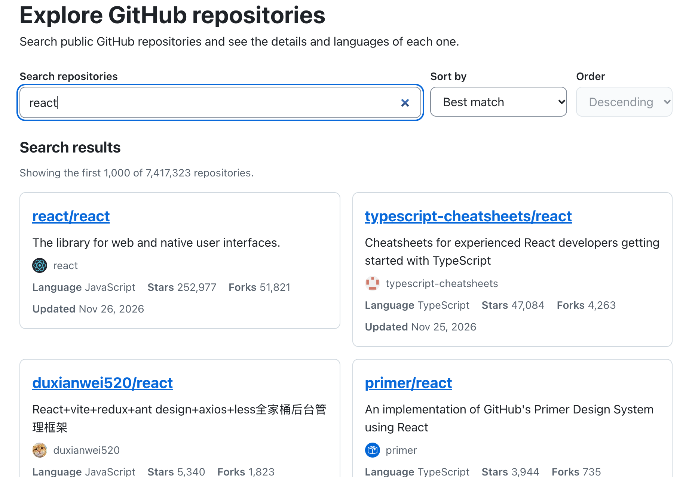
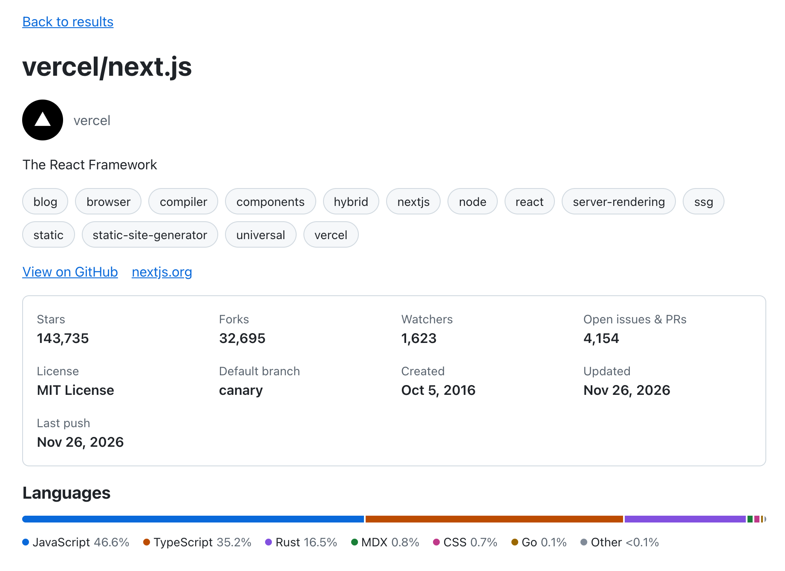

# repo-explorer

Search public GitHub repositories and see the details and languages of each one.

**Live:** https://repo-explorer-theta.vercel.app





## Features

- Search public repositories by name or keyword. The request starts 500 ms after you stop typing, or at once on Enter; queries need at least 2 characters.
- Sort by best match, or by stars, forks, help wanted issues or recent update in descending or ascending order.
- 20 results per page, up to the 1,000 results GitHub returns for a search.
- Each result shows the owner, description, language, stars, forks and last update date, and links to the repository's page in the app.
- Separate views for loading, no results, network and server errors, and the GitHub rate limit.
- A repository page with the owner, description, topics, star, fork, watcher and open issue counts, license, default branch, dates, links to GitHub and the homepage, and the share of each language.
- The repository page has its own loading, not found, error and rate limit states. A failed languages request does not take the page down.
- "Back to results" returns to the same search.
- Page titles, focus and the scroll position follow navigation.
- No sign-in or token.

## Technical highlights

- **The URL holds the search state** (`q`, `sort`, `order`, `page`), so a search can be shared and Back works. A route loader rewrites invalid or redundant parameters with a replace navigation, so they do not add history entries. A page past the last one is replaced with the last page.
- **Rate limit handling.** Without a token GitHub allows 10 search requests per minute and 60 other requests per hour; a repository page takes two. The two limits have separate gates. After a rate limit response, the gate stops further requests of its kind until the reset time: a new search or repository shows that it is paused, with a countdown, and loads on its own afterwards. Typing is debounced and rate limit errors are not retried, so the quota is not wasted.
- **Previous results stay on screen while the next ones load**, marked with a loading line and `aria-busy`. Old empty results and pages past the last one show a skeleton instead, so "no results" does not flash before the real answer.
- **Accessibility.** One persistent `status` region announces outcomes and one `alert` region announces errors, because a live region added together with its text is announced unreliably. Focus follows Previous, Next and Retry so keyboard users are not left at the top of the document. After navigation it moves to the page heading, and coming back from a repository it returns to the card that was opened. The language bar is hidden from screen readers; the list under it carries the same data. `eslint-plugin-jsx-a11y` is part of the ESLint setup.
- **Addresses and links.** The repository address is replaced with the canonical one after a rename or a different case. The homepage of a repository is free text, so only `http` and `https` links are shown.
- **Tests.** 590+ tests with Vitest, React Testing Library and MSW, which mocks GitHub at the network level so the real request code runs. While writing them, each new test was checked by temporarily breaking the code it covers and seeing it fail.
- **Checks before code lands.** Strict TypeScript; a pre-commit hook runs ESLint, Stylelint, Prettier and the type check on staged changes; GitHub Actions runs lint, format check, type check, tests and the build on every pull request.

## Tech stack

- React 19.3, TypeScript 6.0 (strict)
- React Router 8.5 (data mode), TanStack Query 5
- SCSS modules, CSS custom properties
- Vite 8.3
- Vitest 5.1, React Testing Library 16, user-event 14, MSW 3
- ESLint 9, Stylelint 17, Prettier 3
- GitHub Actions, Vercel

## Getting started

Requires Node 24.

```sh
npm ci
npm run dev
```

| Command                 | What it does                        |
| ----------------------- | ----------------------------------- |
| `npm test`              | Run the tests once                  |
| `npm run test:watch`    | Run the tests in watch mode         |
| `npm run test:coverage` | Run the tests with coverage         |
| `npm run lint`          | ESLint                              |
| `npm run stylelint`     | Stylelint for SCSS                  |
| `npm run format:check`  | Check formatting with Prettier      |
| `npm run typecheck`     | Type check with `tsc`               |
| `npm run build`         | Type check and build for production |
| `npm run preview`       | Serve the production build locally  |

## Project structure

```
src/
  api/                     GitHub client, requests, typed errors, query client
  app/                     providers, router, routes and app-level tests
  components/ErrorNotice/  error and rate limit notices
  components/Layout/       header, focus and scroll after navigation
  features/rateLimit/      gates for the search and core limits
  features/repository/     repository page hooks and components
  features/search/         search state, hooks, components, return to results
  lib/                     formatters, avatars, error messages, shared hooks
  pages/                   route components
  styles/                  tokens, reset and mixins
  test/                    test setup, fixtures and render helpers
```

## Known limitations

- An in-app navigation to a non-canonical URL replaces the current history entry. The app only builds canonical links.
- Changing only the sort or page does not cancel text still waiting for the debounce.
- A cached result with the same announcement text is not announced again.
- Within the search, focus is moved only by Previous, Next and Retry; a focused card or link that disappears drops focus to the page body.
- The scroll position is not restored when the results are no longer cached.
- "Back to results" creates a new history entry, so browser Back after it returns to the repository.
- Returning focus to the opened card does not survive a reload.
- Without a token GitHub allows about 30 repository pages an hour.
- Avatars are requested with an `s` size parameter that GitHub does not document. If it stops working, the full image is shown at the same size.

## Roadmap

- Theme: light, dark and system
- Filters
- Favorites
- The repository's README on its page, sanitized with DOMPurify
- Accessibility and test pass
- Performance and Lighthouse
- Own favicon instead of the Vite one

## Author

Oleksandr Chaika — [LinkedIn](https://www.linkedin.com/in/oleksander-chaika-466172422)
